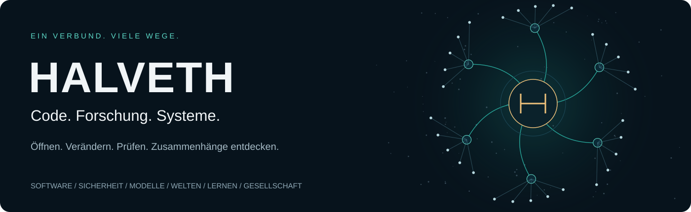
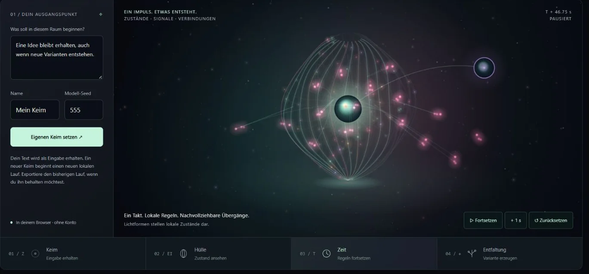
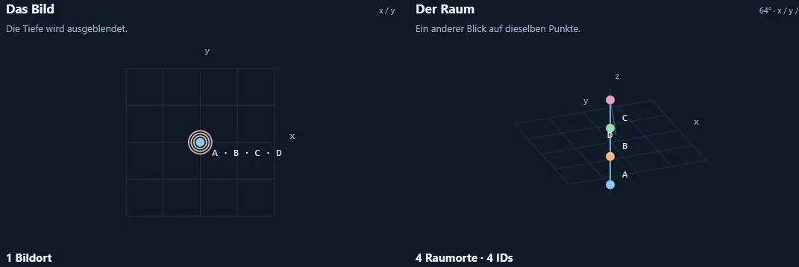

[Deutsch](README.md) · [English](README.en.md) · [Русский](README.ru.md)

# Juri · Developer

I build local tools, web applications and interactive models. **HALVETH** connects this work to its source revisions and checks. Python · JavaScript · Windows · browser-local applications.

**Go straight to results:** [Mein Lernportal](https://juri-halveth.github.io/mein-lernportal/) · [Field Difference Lab](https://juri-halveth.github.io/halveth-field-difference-lab/) · [Selected projects](https://juri-halveth.github.io/en/arbeiten/) · [Collaborate](#collaborate)

## Four selected projects

Four entry points from 18 public project and source entries. The first two run in the browser; NOVA and Tresor are local projects with a guide or release.

- **Mein Lernportal:** Learn digital skills and programming without a required account. [Open a lesson directly ↗](https://juri-halveth.github.io/mein-lernportal/)
- **Field Difference Lab:** Compare movement from the same initial state under two model rules. [Open the model directly ↗](https://juri-halveth.github.io/halveth-field-difference-lab/)
- **NOVA:** Recover notes and code and resume traceable work with preserved corrections. [Guide and offline demo ↗](https://github.com/Juri-Halveth/lucinet-seedspace)
- **Tresor:** Manage credentials locally on Windows. [Release and setup guide ↗](https://github.com/Juri-Halveth/halveth-tresor)

[Two verified case studies](https://juri-halveth.github.io/en/belege/) show inputs, results and counterchecks.

## Optional: Starship Lab

The [Starship Lab](https://juri-halveth.github.io/universum/) connects 18 public project and source entries as an interactive laboratory. Every project link is also available through a plain list without flight controls. A project can belong to several topics; each card appears once.

| Topic area | What you can explore |
| --- | --- |
| **Software & tools** | Local applications, development tools and workflows. |
| **Security & evidence** | Inspectable sources, counterchecks and security models. |
| **Models & visualization** | Perspectives, states, time and differences. |
| **Worlds & interaction** | Interactive scenes and rule-bound worlds. |
| **Learning & knowledge** | Digital foundations, exercises and learning paths. |
| **Society & sources** | Public research and separately identified reform proposals. |

[Catalog snapshot and source mapping · 01.11.2026](https://github.com/Juri-Halveth/Juri-Halveth.github.io/blob/b7589d82ed4a50fb0507055840376a27c2cc6145/universum/data/catalog.js)

## Work with states, time and variants

**States, time and variants**

Set text, derive a variant, observe states and take the result as JSON. Light bodies show how the local model evolves. For interactive explanations, variant comparison and traceable state sequences.

[Try it yourself ↗](https://juri-halveth.github.io/halveth-scarlet/?lang=en)

JavaScript runs locally in your browser. Text states and rule-based cell movement are separate models.

More spaces in this browser application: [1001 / Constellation · 68 entities](https://juri-halveth.github.io/halveth-scarlet/entities/?lang=en) · [Wave · 68 forms](https://juri-halveth.github.io/halveth-scarlet/entities/?view=chain&lang=en#scarlet). [Project source · c36150b](https://github.com/Juri-Halveth/halveth-scarlet/blob/c36150b55fe9ed4207f185d7092b3184c353df93/README.md#L47-L66).

## Distinguish image and space

**Distinguish image and space**

Four points, two views: a projection can hide distinct spatial positions. With a time control and counterexamples. For camera debugging, technical learning and understandable model comparisons.

[Try it yourself ↗](https://juri-halveth.github.io/halveth-forschungslabor/endeck/)

Geometric model · not a measurement of unknown real processes.

## What I contribute in practice

Browser interfaces, local Python tools, counterexamples and reproducible builds. The interface map connects those skills directly to functions, tests and source revisions.

[**Connected engineering examples**](TECHNICAL-MAP.en.md) · [Selected projects](https://juri-halveth.github.io/en/arbeiten/#repositories)

## Collaborate

I develop interactive prototypes, technical explanations and local tools. A collaboration starts with a specific goal, an agreed scope and inspectable acceptance criteria.

**[juri@halveth.de](mailto:juri@halveth.de)** · Security: [security@halveth.de](mailto:security@halveth.de)

---

Project lead, direction and curation: Juri / HALVETH. AI-assisted development. Captures show actual browser states.

[Capture provenance and processing](ASSET-NOTICES.md) · [HALVETH](https://juri-halveth.github.io/en/)
