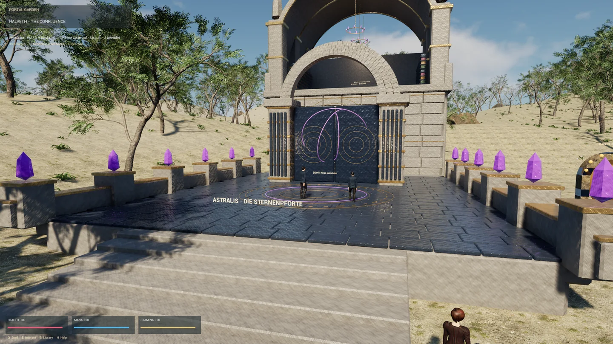

[Deutsch](README.md) · [English](README.en.md) · [Русский](README.ru.md)

# Juri

Ich bin **Juri**. Ich baue Werkzeuge, mit denen sich Zustände verändern, Abläufe beobachten und Ideen weiterentwickeln lassen.

**Idee öffnen. Etwas verändern. Ergebnis ansehen. Dahinter liegt der Code.**

[**Portfolio öffnen ↗**](https://juri-halveth.github.io/) · [Drei nachvollziehbare Fallstudien](https://juri-halveth.github.io/belege/)

## Mit Zuständen, Zeit und Varianten arbeiten

**Zustände, Zeit und Varianten**

Text setzen, eine Variante ableiten, Zustände beobachten und als JSON mitnehmen. Lichtkörper zeigen die Entwicklung des lokalen Modells. Für interaktive Erklärungen, Variantenvergleich und nachvollziehbare Zustandsabläufe.

[Selbst ausprobieren ↗](https://juri-halveth.github.io/halveth-scarlet/)

JavaScript läuft lokal im Browser. Textzustände und regelbasierte Zellbewegung sind getrennte Modelle.

## Bild und Raum unterscheiden

**Bild und Raum unterscheiden**

Vier Punkte, zwei Ansichten: eine Projektion kann verschiedene Raumorte verdecken. Mit Zeitregler und Gegenproben. Für Kamera-Debugging, technische Lernangebote und verständliche Modellvergleiche.

[Selbst ausprobieren ↗](https://juri-halveth.github.io/halveth-forschungslabor/endeck/)

Geometrisches Modell · keine Messung unbekannter realer Vorgänge.

## Eine Anwendung: Raum und Bewegung

**Raum und Bewegung**

Fliegen, Portale öffnen und Bewohnern begegnen. Ein nativer C++-Prototyp in Unreal Engine. Für räumliche Prototypen, interaktive Ausstellungen und Spielkonzepte.

[Code dieser Entwicklungsfassung ↗](https://github.com/Juri-Halveth/halveth-unreal/tree/5c2260f85d5275c15082c5c7d38ae51a143a5688)

Aufnahme aus der nativen Entwicklungsfassung.

Die Aufnahme zeigt die Entwicklungsfassung; veröffentlichte Download-Pakete haben ihren eigenen Versionsstand.

## Was ich praktisch einbringe

C++-Spielzustände, Browseroberflächen, lokale Python-Werkzeuge, Gegenproben und reproduzierbare Builds. Die Schnittstellenkarte führt von diesen Fähigkeiten direkt zu Funktionen, Tests und Quellrevisionen.

[**Technik im Zusammenhang**](TECHNICAL-MAP.md) · [Alle öffentlichen Projekte](https://juri-halveth.github.io/arbeiten/#repositories)

## Zusammenarbeit

Ich entwickle interaktive Prototypen, technische Erklärungen und lokale Werkzeuge. Für eine Zusammenarbeit vereinbaren wir ein konkretes Ziel, den Umfang und nachvollziehbare Abnahmekriterien.

**[security@halveth.de](mailto:security@halveth.de)**

---

Projektleitung, Richtung und Auswahl: Juri / HALVETH. Entwicklung mit KI-Unterstützung. Die Aufnahmen zeigen tatsächliche native Anwendungen und Browserzustände.

[Herkunft und Verarbeitung der Aufnahmen](ASSET-NOTICES.md) · [HALVETH](https://juri-halveth.github.io/)
