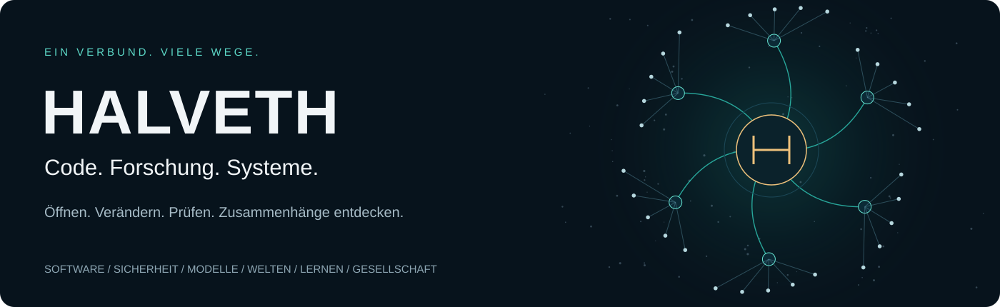
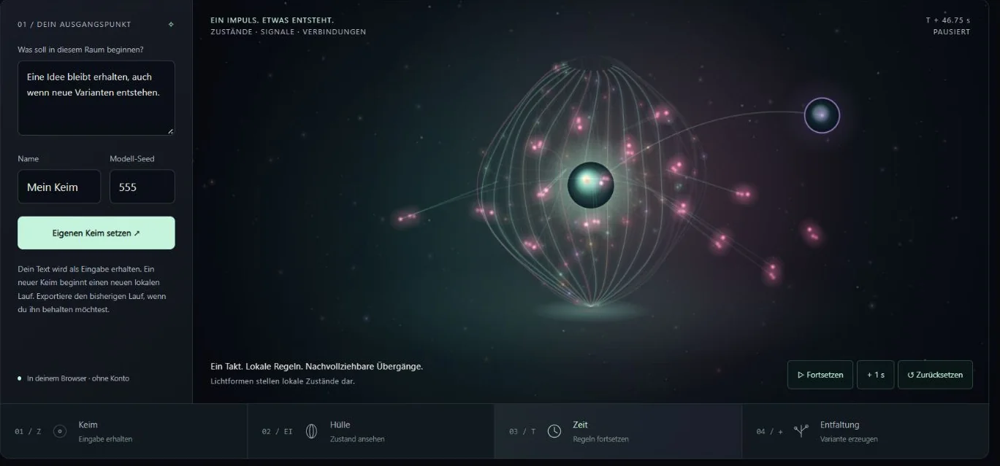
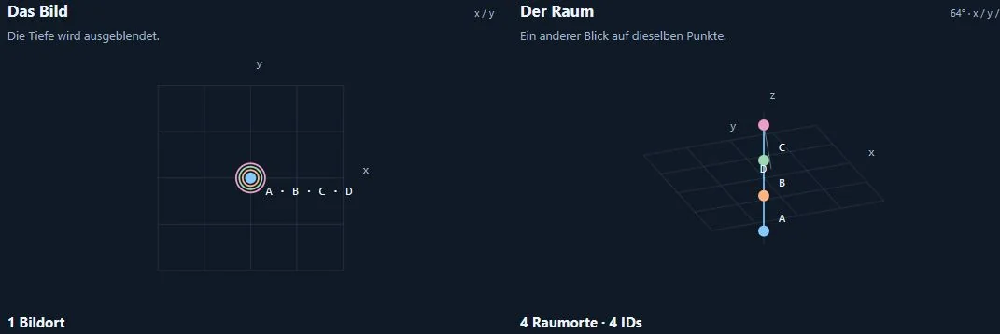

[Deutsch](README.md) · [English](README.en.md) · [Русский](README.ru.md)

# Juri · Entwickler

Ich entwickle lokale Werkzeuge, Webanwendungen und interaktive Modelle. **HALVETH** verbindet diese Arbeiten mit ihren Quellständen und Prüfungen. Python · JavaScript · Windows · browserlokale Anwendungen.

**Direkt zu Ergebnissen:** [Mein Lernportal](https://juri-halveth.github.io/mein-lernportal/) · [Field Difference Lab](https://juri-halveth.github.io/halveth-field-difference-lab/) · [Ausgewählte Projekte](https://juri-halveth.github.io/arbeiten/) · [Zusammenarbeit](#zusammenarbeit)

## Vier ausgewählte Arbeiten

Vier Einstiege aus 18 öffentlichen Projekt- und Quelleneinträgen. Die ersten beiden laufen im Browser; NOVA und Tresor sind lokale Projekte mit Anleitung beziehungsweise Release.

- **Mein Lernportal:** Digitale Grundlagen und Programmierung ohne Pflichtkonto lernen. [Lektion direkt öffnen ↗](https://juri-halveth.github.io/mein-lernportal/)
- **Field Difference Lab:** Bewegungen aus derselben Ausgangslage unter zwei Modellregeln vergleichen. [Modell direkt öffnen ↗](https://juri-halveth.github.io/halveth-field-difference-lab/)
- **NOVA:** Frühere Notizen und Code wiederfinden und Korrekturen nachvollziehbar fortsetzen. [Anleitung und Offline-Demo ↗](https://github.com/Juri-Halveth/lucinet-seedspace)
- **Tresor:** Zugangsdaten lokal unter Windows verwalten. [Release und Startanleitung ↗](https://github.com/Juri-Halveth/halveth-tresor)

[Zwei überprüfte Fallstudien](https://juri-halveth.github.io/belege/) zeigen Eingabe, Ergebnis und Gegenprobe.

## Optional: Starship Lab

Das [Starship Lab](https://juri-halveth.github.io/universum/) verbindet 18 öffentliche Projekt- und Quelleneinstiege als interaktives Labor. Jeder Projektlink lässt sich auch ohne Flugmodus über die Projektliste öffnen. Ein Projekt kann mehrere Themen berühren; jede Karte erscheint einmal.

| Themenraum | Was dort erkundet wird |
| --- | --- |
| **Software & Werkzeuge** | Lokale Anwendungen, Entwicklungswerkzeuge und Arbeitsabläufe. |
| **Sicherheit & Belege** | Prüfbare Quellen, Gegenproben und Sicherheitsmodelle. |
| **Modelle & Visualisierung** | Perspektiven, Zustände, Zeit und Unterschiede. |
| **Welten & Interaktion** | Interaktive Szenen und regelgebundene Welten. |
| **Lernen & Wissen** | Digitale Grundlagen, Übungen und Lernpfade. |
| **Gesellschaft & Quellen** | Öffentliche Recherche und getrennte Reformvorschläge. |

[Katalogstand und Quellzuordnung · 01.11.2026](https://github.com/Juri-Halveth/Juri-Halveth.github.io/blob/b7589d82ed4a50fb0507055840376a27c2cc6145/universum/data/catalog.js)

## Mit Zuständen, Zeit und Varianten arbeiten

**Zustände, Zeit und Varianten**

Text setzen, eine Variante ableiten, Zustände beobachten und als JSON mitnehmen. Lichtkörper zeigen die Entwicklung des lokalen Modells. Für interaktive Erklärungen, Variantenvergleich und nachvollziehbare Zustandsabläufe.

[Selbst ausprobieren ↗](https://juri-halveth.github.io/halveth-scarlet/)

JavaScript läuft lokal im Browser. Textzustände und regelbasierte Zellbewegung sind getrennte Modelle.

Weitere Räume dieser Browseranwendung: [1001 / Konstellation · 68 Entitäten](https://juri-halveth.github.io/halveth-scarlet/entities/) · [Welle · 68 Formen](https://juri-halveth.github.io/halveth-scarlet/entities/?view=chain#scarlet). [Projektquelle · c36150b](https://github.com/Juri-Halveth/halveth-scarlet/blob/c36150b55fe9ed4207f185d7092b3184c353df93/README.md#L47-L66).

## Bild und Raum unterscheiden

**Bild und Raum unterscheiden**

Vier Punkte, zwei Ansichten: eine Projektion kann verschiedene Raumorte verdecken. Mit Zeitregler und Gegenproben. Für Kamera-Debugging, technische Lernangebote und verständliche Modellvergleiche.

[Selbst ausprobieren ↗](https://juri-halveth.github.io/halveth-forschungslabor/endeck/)

Geometrisches Modell · keine Messung unbekannter realer Vorgänge.

## Was ich praktisch einbringe

Browseroberflächen, lokale Python-Werkzeuge, Gegenproben und reproduzierbare Builds. Die Schnittstellenkarte führt von diesen Fähigkeiten direkt zu Funktionen, Tests und Quellrevisionen.

[**Technik im Zusammenhang**](TECHNICAL-MAP.md) · [Ausgewählte Projekte](https://juri-halveth.github.io/arbeiten/#repositories)

## Zusammenarbeit

Ich entwickle interaktive Prototypen, technische Erklärungen und lokale Werkzeuge. Für eine Zusammenarbeit vereinbaren wir ein konkretes Ziel, den Umfang und nachvollziehbare Abnahmekriterien.

**[juri@halveth.de](mailto:juri@halveth.de)** · Security: [security@halveth.de](mailto:security@halveth.de)

---

Projektleitung, Richtung und Auswahl: Juri / HALVETH. Entwicklung mit KI-Unterstützung. Die Aufnahmen zeigen tatsächliche Browserzustände.

[Herkunft und Verarbeitung der Aufnahmen](ASSET-NOTICES.md) · [HALVETH](https://juri-halveth.github.io/)
