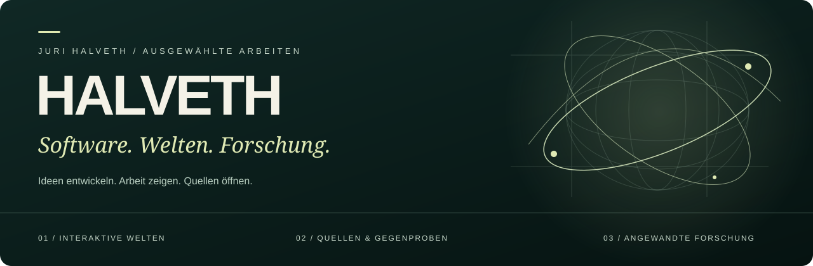

[Deutsch](README.md) · [English](README.en.md) · [Русский](README.ru.md)

# Juri

**Person: Juri. Projekt: HALVETH.** [Namenszuordnung](IDENTITY.md).



**Systeme verstehen. Welten erschaffen.**

Unter **HALVETH** verbinde ich technische Ideen mit konkreten Anwendungen: vom lokalen Desktopwerkzeug über spielbare Prototypen bis zum frei zugänglichen Lernportal. Hier findest du ausgewählte Arbeiten und den direkten Weg zu Oberfläche, Code und Dokumentation.

[**Portfolio ansehen →**](https://juri-halveth.github.io/) · [**Arbeitsproben →**](https://juri-halveth.github.io/koennen/) · [**Arbeitsprofil →**](https://juri-halveth.github.io/profil/)


## In 60 Sekunden nachprüfen

[Drei kurze Fallstudien mit Eingabe, Ergebnis, Gegenprobe und passendem CI-Lauf](https://juri-halveth.github.io/belege/). Jeder Lauf ist an seinen exakten Quellstand gebunden.

Projektverantwortung: Juri / HALVETH — Richtung, Gestaltung und Auswahl. Entwicklung mit KI-Unterstützung; die dokumentierten lokalen Prüfungen wurden im Agenten-Arbeitslauf ausgeführt. Eine persönliche Fachprüfung und ein unabhängiges Audit bleiben eigene Prüfungen.

## Drei direkte Einstiege

### 01 / ASHBOUND · eine native Spielwelt

Ein eigenständiges Unreal-Projekt mit Aschetal, Archiv, Zaubern und Büchern im 3D-Raum. **Windows-Vorschau v0.4.2** und Entwicklungsquellen sind getrennte Stände.

[Windows-Vorschau](https://github.com/Juri-Halveth/halveth-scarlet/releases/tag/ashbound-native-v0.4.2-portal-preview) · [Unreal-Quellen](https://github.com/Juri-Halveth/halveth-scarlet/blob/b768ca093d9bd68b1453a8ccc5b6d02ecaa1eb07/native/ashbound-unreal/README.md)

### 02 / SCARLET · Grafik zum Ausprobieren

Die **Singularity Cannon** macht eine grafische Idee unmittelbar bedienbar. Öffnen, ausprobieren und anschließend die Implementierung ansehen.

[Szene öffnen](https://juri-halveth.github.io/halveth-scarlet/forschung/singularity-cannon/) · [SCARLET-Quellen](https://github.com/Juri-Halveth/halveth-scarlet)

### 03 / Forschungslabor · Code mit Gegenproben

Zehn lokale JavaScript- und Python-Module für Quellenpakete, Bildvergleich, Optik, Ereignisse und Regeln. **145 lokale Tests bestanden** im Lauf vom 20.10.2026: 99 JavaScript und 46 Python. Der Prüfstand gilt für die mitgelieferten Modellverträge.

[Geprüfter Quellstand](https://github.com/Juri-Halveth/halveth-forschungslabor/tree/c6008ab5f8847921dc140d973b9a526750a89933) · [Prüfprotokoll](https://juri-halveth.github.io/docs/WORK-SAMPLE-VALIDATION-2026-10-20.md)

<details>
<summary>Prüfung selbst nachvollziehen</summary>

Voraussetzungen: Node.js 24 und Python 3.11 oder neuer.

```sh
git clone https://github.com/Juri-Halveth/halveth-forschungslabor.git
cd halveth-forschungslabor
git checkout c6008ab5f8847921dc140d973b9a526750a89933
npm test
```

</details>


## Technik im Zusammenhang

**Ich entwickle und untersuche die Schnittstellen zwischen Systemen.**

Die [**technische Schnittstellenkarte**](TECHNICAL-MAP.md) führt von sieben Themen direkt zu 14 konkreten Arbeitsproben: Oberfläche und Python, C++ und Spielzustand, Security-Logik, Quellenpakete, Grafikmodelle sowie Build und Veröffentlichung. Jede Arbeitsprobe nennt Funktion, Gegenprobe oder Builddefinition und ihren exakten Quellstand.

[Karte auf GitHub](TECHNICAL-MAP.md) · [Visuell erkunden](https://juri-halveth.github.io/koennen/) · [Quellenpaket in Node und Browser](TECHNICAL-MAP.md#node-browser-packet) · [C++-Zustandskern](TECHNICAL-MAP.md#cpp-state)

## Weitere Arbeiten

### Lernen, das direkt zugänglich ist

**Mein Lernportal** bietet 702 Lektionen mit Übungen zu digitalen Grundlagen, Programmierung, Mathematik und weiteren Themen. Der Katalog lässt sich ohne Pflichtkonto öffnen.

[Direkt lernen](https://juri-halveth.github.io/mein-lernportal/) · [Code und Aufbau](https://github.com/Juri-Halveth/mein-lernportal)

### Lokale Software für den Alltag

**Tresor** ist ein Windows-Projekt zur lokalen Verwaltung von Zugangsdaten. **Fortuna** ist eine Browseroberfläche mit JavaScript-Modellen zum Vergleich selbst eingegebener Möglichkeiten. Beide Projekte dokumentieren ihren jeweiligen Entwicklungsstand.

[Tresor ansehen](https://github.com/Juri-Halveth/halveth-tresor) · [Fortuna ansehen](https://github.com/Juri-Halveth/fortuna)

### Spielwelten und interaktive Gestaltung

**Portal Garden** ist ein eigenständiger C++-Spielprototyp für Unreal Engine. **Scarlet Garden** erkundet prozedurale Fantasywelten. **SCARLET** bündelt interaktive Szenen und Forschungsdemos.

[Portal Garden · C++](https://github.com/Juri-Halveth/halveth-unreal) · [Scarlet Garden](https://github.com/Juri-Halveth/halveth-realms) · [Demos entdecken](https://juri-halveth.github.io/halveth-scarlet/forschung/wegweiser/)

### Forschung, die man nachvollziehen kann

Das **HALVETH Forschungslabor** enthält zehn ausgewählte lokale Module mit Tests, darunter Bildvergleich, Quellenpakete, Optik und Regelmodelle. Das **Feldlabor** macht Bewegung und Zustandswechsel sichtbar. Veröffentlichte Quellen, Gegenproben und offene Fragen gehören zur jeweiligen Arbeit.

[Forschungslabor](https://github.com/Juri-Halveth/halveth-forschungslabor) · [Feldlabor ausprobieren](https://juri-halveth.github.io/halveth-field-difference-lab/) · [Prüfmethoden](https://juri-halveth.github.io/audits/)

## Was ich in ein Projekt einbringe

- **Softwareentwicklung:** lokale Werkzeuge, Weboberflächen und technische Prototypen.
- **Qualität und Nachvollziehbarkeit:** nachvollziehbare Fehlerbeschreibungen, Gegenproben und dokumentierte Entwicklungsstände.
- **Gestaltung und Wissensvermittlung:** interaktive Erklärungen, Lernpfade und verständliche Oberflächen.

Die Arbeitsproben zeigen den konkreten Umfang. Bei jedem Projekt lohnt sich der Blick auf Quellstand, Einstieg und aktuelle Prüfungen. KI-gestützte Entwicklung ist Teil des Arbeitsprozesses; veröffentlichter Code und seine dokumentierten Ergebnisse bleiben überprüfbar.

## Zusammenarbeit

Für Gespräche über Softwareentwicklung, technische Prototypen, Lernangebote oder einen klar umrissenen Review: **[security@halveth.de](mailto:security@halveth.de)**.

[Fachliches Arbeitsprofil](https://juri-halveth.github.io/profil/) · [Alle öffentlichen Arbeiten](https://juri-halveth.github.io/arbeiten/) · [Technische Arbeitsproben mit Quellzeilen](https://juri-halveth.github.io/koennen/)
