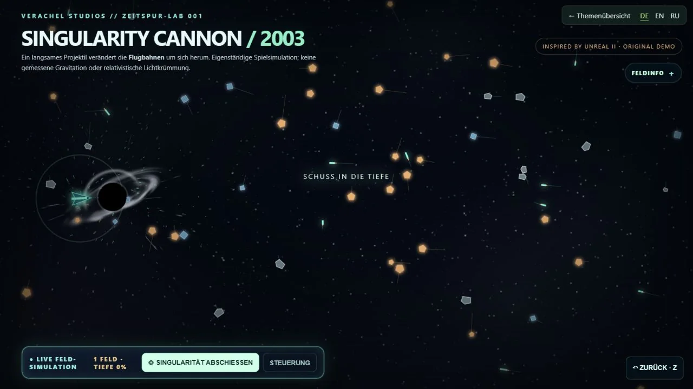

[Deutsch](README.md) · [English](README.en.md) · [Русский](README.ru.md)

# Juri

Ich bin **Juri**. Unter **HALVETH** verbinde ich Gestaltung, Software und spielbare Modelle.

**Idee öffnen. Etwas verändern. Ergebnis ansehen. Dahinter liegt der Code.**

[**Portfolio öffnen ↗**](https://juri-halveth.github.io/) · [Drei nachvollziehbare Fallstudien](https://juri-halveth.github.io/belege/)

## Eine Spielwelt zum Erkunden

**ASTRALIS · begehbare Spielwelt**

Fliegen, Portale öffnen und Bewohnern begegnen. Ein nativer C++-Prototyp in Unreal Engine. Für spielbare Raumkonzepte und interaktive Ausstellungen.

[Code dieser Entwicklungsfassung ↗](https://github.com/Juri-Halveth/halveth-unreal/tree/5c2260f85d5275c15082c5c7d38ae51a143a5688)

Die Aufnahme zeigt die Entwicklungsfassung; veröffentlichte Download-Pakete haben ihren eigenen Versionsstand.

## Webgrafik, die auf dich reagiert

**SCARLET · ein Feld reagiert**

Ein Projektil verändert die Bahnen im Feld. Steuerung, Rücknahme und sichtbare Zustände greifen ineinander. Für interaktive Produktdemos, Webgrafik und spielerische Erklärungen.

[Selbst ausprobieren ↗](https://juri-halveth.github.io/halveth-scarlet/forschung/singularity-cannon/)

## Eine andere Ansicht verändert, was du erkennen kannst

**ENDECK · Bild und Raum unterscheiden**

Vier Punkte, zwei Ansichten: eine Projektion kann verschiedene Raumorte verdecken. Mit Zeitregler und Gegenproben. Für Kamera-Debugging, technische Lernangebote und verständliche Modellvergleiche.

[Selbst ausprobieren ↗](https://juri-halveth.github.io/halveth-forschungslabor/endeck/)

## Was ich praktisch einbringe

C++-Spielzustände, Browseroberflächen, lokale Python-Werkzeuge, Gegenproben und reproduzierbare Builds. Die Schnittstellenkarte führt von diesen Fähigkeiten direkt zu Funktionen, Tests und Quellrevisionen.

[**Technik im Zusammenhang**](TECHNICAL-MAP.md) · [Alle öffentlichen Projekte](https://juri-halveth.github.io/arbeiten/#repositories)

## Zusammenarbeit

Ich entwickle interaktive Prototypen, technische Erklärungen und lokale Werkzeuge. Für eine Zusammenarbeit vereinbaren wir ein konkretes Ziel, den Umfang und nachvollziehbare Abnahmekriterien.

**[security@halveth.de](mailto:security@halveth.de)**

---

Projektleitung, Richtung und Auswahl: Juri / HALVETH. Entwicklung mit KI-Unterstützung. Die Aufnahmen zeigen tatsächliche Spiel- und Browserzustände.

[Herkunft und Verarbeitung der Aufnahmen](ASSET-NOTICES.md) · [HALVETH](https://juri-halveth.github.io/)
