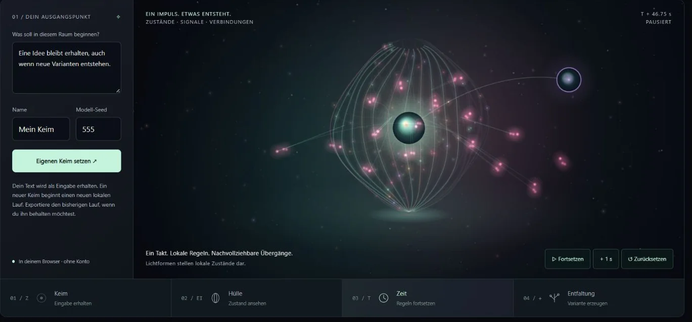
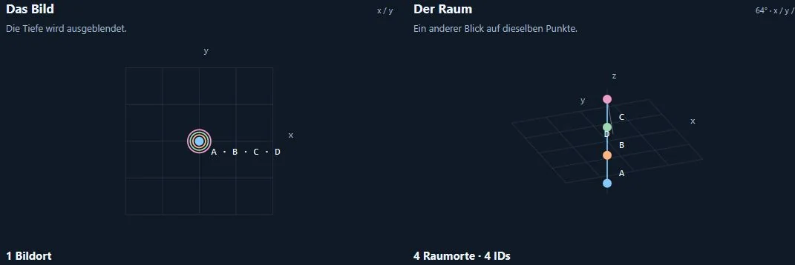

[Deutsch](README.md) · [English](README.en.md) · [Русский](README.ru.md)

# Juri

Я **Juri**. Я создаю инструменты для изменения состояний, наблюдения последовательностей и развития идей.

**Откройте идею. Измените что-нибудь. Посмотрите результат. За ним стоит код.**

[**Открыть портфолио ↗**](https://juri-halveth.github.io/ru/) · [Два проверенных примера](https://juri-halveth.github.io/ru/belege/)

## Работа с состояниями, временем и вариантами

**Состояния, время и варианты**

Задайте текст, создайте вариант, наблюдайте состояния и сохраните результат в JSON. Световые тела показывают развитие локальной модели. Для интерактивных объяснений, сравнения вариантов и отслеживаемых последовательностей состояний.

[Попробовать самому ↗](https://juri-halveth.github.io/halveth-scarlet/?lang=ru)

JavaScript работает локально в браузере. Текстовые состояния и движение клеток по правилам — отдельные модели.

## Различать изображение и пространство

**Различать изображение и пространство**

Четыре точки, два вида: проекция скрывает разные положения в пространстве. Время и контрпримеры доступны. Для отладки камер, обучения и понятного сравнения моделей.

[Попробовать самому ↗](https://juri-halveth.github.io/halveth-forschungslabor/endeck/)

Геометрическая модель, не измерение неизвестных реальных процессов.

## Мой практический вклад

Браузерные интерфейсы, локальные инструменты Python, контрпримеры и воспроизводимые сборки. Карта интерфейсов ведёт от этих навыков к функциям, тестам и версиям кода.

[**Технические примеры во взаимосвязи**](TECHNICAL-MAP.ru.md) · [Избранные проекты](https://juri-halveth.github.io/ru/arbeiten/#repositories)

## Сотрудничество

Я создаю интерактивные прототипы, технические объяснения и локальные инструменты. Для совместной работы согласуем конкретную цель, объём и проверяемые критерии приёмки.

**[security@halveth.de](mailto:security@halveth.de)**

---

Руководство, направление и подбор: Juri / HALVETH. Разработка с помощью ИИ. Снимки показывают реальные состояния браузера.

[Происхождение и обработка снимков](ASSET-NOTICES.md) · [HALVETH](https://juri-halveth.github.io/ru/)
