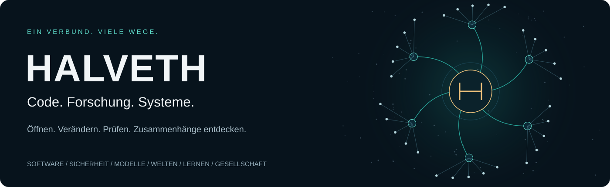
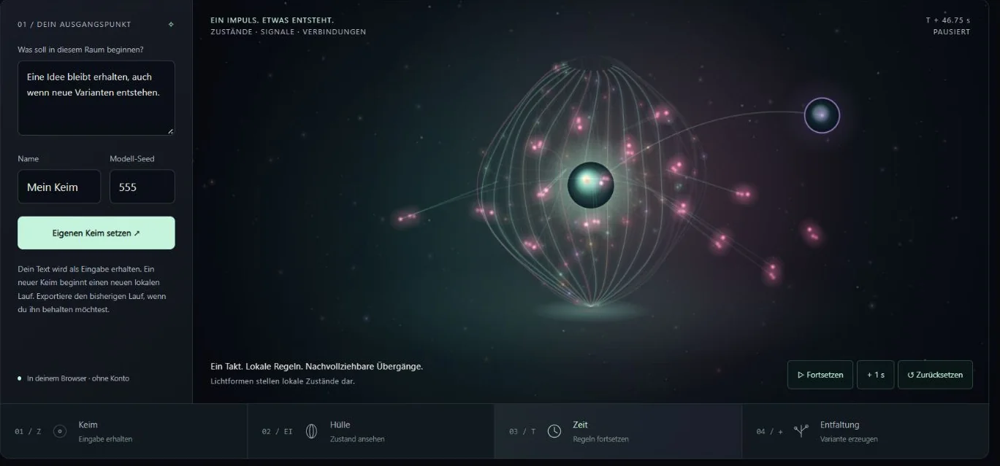
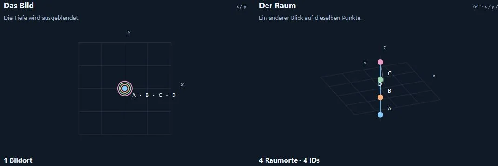

[Deutsch](README.md) · [English](README.en.md) · [Русский](README.ru.md)

# Juri · Разработчик

Я создаю локальные инструменты, веб-приложения и интерактивные модели. **HALVETH** связывает эти работы с версиями кода и проверками. Python · JavaScript · Windows · приложения, работающие локально в браузере.

**Сразу к результатам:** [Mein Lernportal](https://juri-halveth.github.io/mein-lernportal/) · [Field Difference Lab](https://juri-halveth.github.io/halveth-field-difference-lab/) · [Избранные проекты](https://juri-halveth.github.io/ru/arbeiten/) · [Сотрудничество](#сотрудничество)

## Четыре избранные работы

Четыре входа из 18 открытых записей о проектах и источниках. Первые два работают в браузере; NOVA и Tresor — локальные проекты с руководством или выпуском.

- **Mein Lernportal:** Цифровые навыки и программирование без обязательного аккаунта. [Открыть урок напрямую ↗](https://juri-halveth.github.io/mein-lernportal/)
- **Field Difference Lab:** Сравнить движения при одинаковом начальном состоянии и двух правилах модели. [Открыть модель напрямую ↗](https://juri-halveth.github.io/halveth-field-difference-lab/)
- **NOVA:** Находить заметки и код, сохранять исправления и продолжать работу. [Руководство и офлайн-демо ↗](https://github.com/Juri-Halveth/lucinet-seedspace)
- **Tresor:** Локально управлять учётными данными Windows. [Выпуск и инструкция ↗](https://github.com/Juri-Halveth/halveth-tresor)

[Два проверенных примера](https://juri-halveth.github.io/ru/belege/) показывают исходные данные, результат и контрпроверку.

## Дополнительно: Starship Lab

[Starship Lab](https://juri-halveth.github.io/universum/) объединяет 18 открытых проектов и источников в интерактивной лаборатории. Ссылки на проекты доступны также в обычном списке без режима полёта. Проект может относиться к нескольким темам; каждая карточка появляется один раз.

| Раздел | Что можно исследовать |
| --- | --- |
| **Программы и инструменты** | Локальные приложения, инструменты разработки и рабочие процессы. |
| **Безопасность и доказательства** | Доступные для проверки источники, контрпроверки и модели безопасности. |
| **Модели и визуализация** | Перспективы, состояния, время и различия. |
| **Миры и взаимодействие** | Интерактивные сцены и миры с явными правилами. |
| **Обучение и знания** | Цифровые основы, упражнения и учебные маршруты. |
| **Общество и источники** | Открытое исследование и отдельно обозначенные предложения реформ. |

[Снимок каталога и привязка к источникам · 01.11.2026](https://github.com/Juri-Halveth/Juri-Halveth.github.io/blob/b7589d82ed4a50fb0507055840376a27c2cc6145/universum/data/catalog.js)

## Работа с состояниями, временем и вариантами

**Состояния, время и варианты**

Задайте текст, создайте вариант, наблюдайте состояния и сохраните результат в JSON. Световые тела показывают развитие локальной модели. Для интерактивных объяснений, сравнения вариантов и отслеживаемых последовательностей состояний.

[Попробовать самому ↗](https://juri-halveth.github.io/halveth-scarlet/?lang=ru)

JavaScript работает локально в браузере. Текстовые состояния и движение клеток по правилам — отдельные модели.

## Различать изображение и пространство

**Различать изображение и пространство**

Четыре точки, два вида: проекция скрывает разные положения в пространстве. Время и контрпримеры доступны. Для отладки камер, обучения и понятного сравнения моделей.

[Попробовать самому ↗](https://juri-halveth.github.io/halveth-forschungslabor/endeck/)

Геометрическая модель, не измерение неизвестных реальных процессов.

## Мой практический вклад

Браузерные интерфейсы, локальные инструменты Python, контрпримеры и воспроизводимые сборки. Карта интерфейсов ведёт от этих навыков к функциям, тестам и версиям кода.

[**Технические примеры во взаимосвязи**](TECHNICAL-MAP.ru.md) · [Избранные проекты](https://juri-halveth.github.io/ru/arbeiten/#repositories)

## Сотрудничество

Я создаю интерактивные прототипы, технические объяснения и локальные инструменты. Для совместной работы согласуем конкретную цель, объём и проверяемые критерии приёмки.

**[juri@halveth.de](mailto:juri@halveth.de)** · Security: [security@halveth.de](mailto:security@halveth.de)

---

Руководство, направление и подбор: Juri / HALVETH. Разработка с помощью ИИ. Снимки показывают реальные состояния браузера.

[Происхождение и обработка снимков](ASSET-NOTICES.md) · [HALVETH](https://juri-halveth.github.io/ru/)
