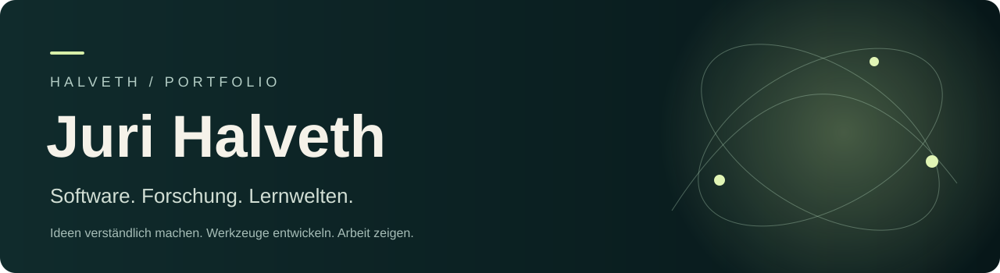

[Deutsch](README.md) · [English](README.en.md) · [Русский](README.ru.md)

# Juri Halveth



**Понимать системы. Создавать миры.**

Под именем **HALVETH** я превращаю технические идеи в приложения: локальные настольные инструменты, игровые прототипы и открытый учебный портал. Здесь собраны избранные работы со ссылками на интерфейс, код и документацию.

[**Портфолио →**](https://juri-halveth.github.io/ru/) · [**Примеры работ →**](https://juri-halveth.github.io/ru/koennen/) · [**Профессиональный профиль →**](https://juri-halveth.github.io/ru/profil/)

## Три прямых входа

### 01 / ASHBOUND · нативный игровой мир

Самостоятельный проект Unreal: пепельная долина, архив, заклинания и книги в 3D-пространстве. **Версия Windows v0.4.2** и исходники разработки относятся к разным состояниям.

[Версия Windows](https://github.com/Juri-Halveth/halveth-scarlet/releases/tag/ashbound-native-v0.4.2-portal-preview) · [Исходники Unreal](https://github.com/Juri-Halveth/halveth-scarlet/blob/b768ca093d9bd68b1453a8ccc5b6d02ecaa1eb07/native/ashbound-unreal/README.md)

### 02 / SCARLET · интерактивная графика

**Singularity Cannon** превращает графическую идею в интерактивную сцену. Откройте, попробуйте управление и изучите реализацию.

[Открыть сцену](https://juri-halveth.github.io/halveth-scarlet/forschung/singularity-cannon/) · [Исходники SCARLET](https://github.com/Juri-Halveth/halveth-scarlet)

### 03 / Лаборатория · код и контрпримеры

Десять локальных модулей JavaScript и Python: пакеты источников, сравнение изображений, оптика, события и правила. **145 локальных тестов пройдены** 20.10.2026: 99 JavaScript и 46 Python. Проверки относятся к предоставленным модельным контрактам.

[Проверенная версия](https://github.com/Juri-Halveth/halveth-forschungslabor/tree/c6008ab5f8847921dc140d973b9a526750a89933) · [Протокол проверки](https://juri-halveth.github.io/docs/WORK-SAMPLE-VALIDATION-2026-10-20.md)

<details>
<summary>Повторить проверку</summary>

Требуются Node.js 24 и Python 3.11 или новее.

```sh
git clone https://github.com/Juri-Halveth/halveth-forschungslabor.git
cd halveth-forschungslabor
git checkout c6008ab5f8847921dc140d973b9a526750a89933
npm test
```

</details>


## Как связаны технические работы

**Я разрабатываю и исследую интерфейсы между системами.**

[**Карта технических интерфейсов**](TECHNICAL-MAP.ru.md) связывает семь областей с 14 конкретными примерами: интерфейсы и Python, C++ и игровые состояния, логика безопасности, пакеты источников, графические модели, сборка и публикация. Каждый пример содержит функцию, контрпример или определение сборки и точную версию исходников.

[Карта на GitHub](TECHNICAL-MAP.ru.md) · [Визуальный обзор](https://juri-halveth.github.io/ru/koennen/) · [Пакеты в Node и браузере](TECHNICAL-MAP.ru.md#node-browser-packet) · [Ядро состояний C++](TECHNICAL-MAP.ru.md#cpp-state)

## Другие работы

### Открытое обучение

**Mein Lernportal** содержит 702 урока и упражнения по цифровым навыкам, программированию, математике и другим темам. Каталог доступен без обязательной регистрации.

[Начать обучение](https://juri-halveth.github.io/mein-lernportal/?lang=ru) · [Код и структура](https://github.com/Juri-Halveth/mein-lernportal)

### Локальные настольные программы

**Tresor** — проект для локального хранения учётных данных в Windows. **Fortuna** — браузерный интерфейс и модели JavaScript для сравнения введённых вариантов. Состояние разработки описано в каждом проекте.

[Tresor](https://github.com/Juri-Halveth/halveth-tresor) · [Fortuna](https://github.com/Juri-Halveth/fortuna)

### Игры и интерактивный дизайн

**Portal Garden** — самостоятельный игровой прототип на C++ для Unreal Engine. **Scarlet Garden** исследует процедурные фэнтезийные миры. **SCARLET** объединяет интерактивные сцены и исследовательские демонстрации.

[Portal Garden · C++](https://github.com/Juri-Halveth/halveth-unreal) · [Scarlet Garden](https://github.com/Juri-Halveth/halveth-realms) · [Демонстрации](https://juri-halveth.github.io/halveth-scarlet/forschung/wegweiser/?lang=ru)

### Исследования с доступными источниками

**Исследовательская лаборатория HALVETH** содержит модели, анализ исходного кода и небольшие инструменты. **Полевая лаборатория** показывает движение и изменения состояний. Источники, контрпримеры и открытые вопросы относятся к конкретной работе.

[Исследовательская лаборатория](https://github.com/Juri-Halveth/halveth-forschungslabor) · [Полевая лаборатория](https://juri-halveth.github.io/halveth-field-difference-lab/) · [Методы проверки](https://juri-halveth.github.io/ru/audits/)

## Что я могу привнести

- **Разработка:** локальные инструменты, веб-интерфейсы и технические прототипы.
- **Качество и прозрачность:** понятные описания ошибок, контрпримеры и документированные версии.
- **Дизайн и обучение:** интерактивные объяснения, учебные маршруты и понятные интерфейсы.

Примеры показывают фактический объём работы. Актуальную версию и проверки следует смотреть в каждом проекте. Разработка с помощью ИИ — часть процесса; опубликованный код и документированные результаты доступны для изучения.

## Сотрудничество

Разработка программ, технические прототипы, учебные инструменты или проверка с определённым объёмом: **[security@halveth.de](mailto:security@halveth.de)**.

[Профессиональный профиль](https://juri-halveth.github.io/ru/profil/) · [Все работы](https://juri-halveth.github.io/ru/arbeiten/) · [Технические примеры](https://juri-halveth.github.io/ru/koennen/)
